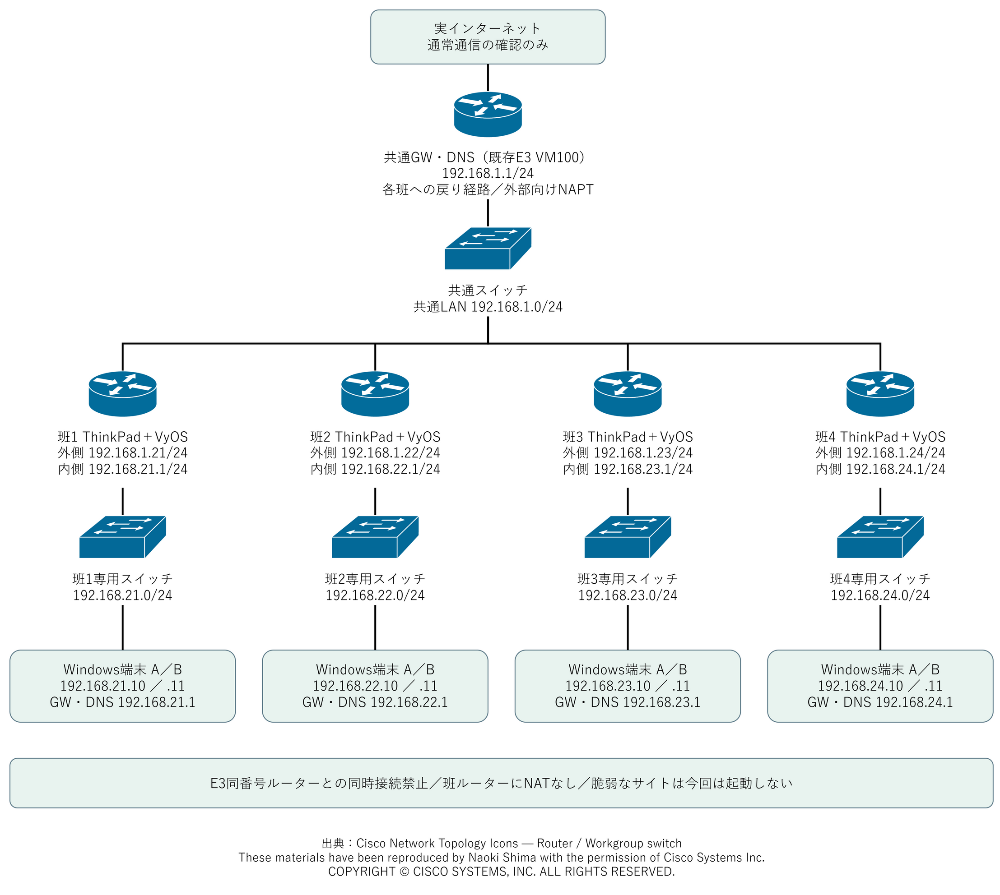

# 2. 実験用ネットワークを確認する

実験LANへ配線する前に、ThinkPadルーター・スイッチ・Windows PCの役割と、自班のアドレスを確認する。

## 通信が通る順序を確認する

自班のWindows PC → 班専用スイッチ → ThinkPadの内側NIC → 外側NIC → 共通スイッチ → 共通GW → インターネット、の順に接続する。他班への通信は共通LANから相手班ルーターへ進む。

スイッチは同じLANの機器をつなぐ。ルーターは異なるLAN間の通信を中継する。ThinkPadはインストール先USBに保存したVyOSを起動してルーターとして使い、Windows PC2台は操作端末として使う。

アイコン出典：[Cisco Network Topology Icons](https://www.cisco.com/c/en/us/about/brand-center/network-topology-icons.html)（Router / Workgroup switch）。図では機器の役割を示す記号として使用しており、実機がCisco製品であることや、Ciscoによる公認を示すものではない。

These materials have been reproduced by Naoki Shima with the permission of Cisco Systems Inc. COPYRIGHT © CISCO SYSTEMS, INC. ALL RIGHTS RESERVED.

## 自班のIPを記録する

表2-1 各班のIPアドレスと担当ドメイン

| 班 | 外側eth0 | 内側eth1・端末のGW/DNS | PC1（A）／PC2（B） | ドメイン |
| --- | --- | --- | --- | --- |
| 1 | 192.168.1.21 | 192.168.21.1 | 192.168.21.10／.11 | alf.lab |
| 2 | 192.168.1.22 | 192.168.22.1 | 192.168.22.10／.11 | bra.lab |
| 3 | 192.168.1.23 | 192.168.23.1 | 192.168.23.10／.11 | cha.lab |
| 4 | 192.168.1.24 | 192.168.24.1 | 192.168.24.10／.11 | del.lab |

すべて`/24`（サブネットマスク`255.255.255.0`）。PC2の`.11`はPC1と先頭3組が同じ。共通LANは`192.168.1.0/24`、共通GW・上流DNSは`192.168.1.1`、配布サーバーは`192.168.1.10`。

班ルーターではNATを設定しない。共通GWに各班LANへの戻り経路があり、インターネットへ出るときに共通GWがNATする。戻り経路と共通GWの許可設定は教員が準備する。同じIPを使うE3機器は同時に接続しない。

PC1のUbuntuをサーバー役`web`、PC2のKali Linuxを通信の確認用端末`atk`として使う。WSLのミラーモードではWindowsと同じ班LANのIPを利用するため、UbuntuやKali Linuxに別の固定IPを追加しない。

任意で[DHCPサービス](../network-construction/dhcp.md)を追加する場合は、各班LANの`.100`～`.199`を自動配布用に使う。PC1の`.10`・PC2の`.11`と重ならず併用できる。

## 完了の確認

班番号、外側IP、内側IP、PC2台のIP、ドメインを記録する。この段階では、本体のLANポートが`eth0`かどうかは未確認である。第6章でLANケーブルを挿し替え、`eth0`・`eth1`のどちらのリンク表示が変わるかを見て確認する。
